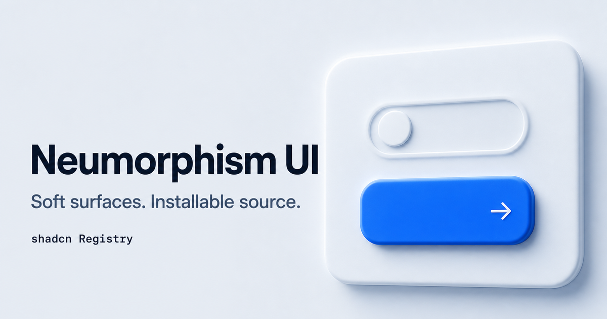

# Neumorphism UI

**Neumorphic React components, charts, and templates.**

Build dashboards, settings screens, content tools, and personal sites with soft
shadows, raised surfaces, and tactile controls. Install the pieces you need with
the shadcn CLI, then customize their React source directly in your application.

[Live demo](https://neumorphism-ui.andongmin.com/en) ·
[Components](https://neumorphism-ui.andongmin.com/en/components) ·
[Templates](https://neumorphism-ui.andongmin.com/en/templates) ·
[Theme Studio](https://neumorphism-ui.andongmin.com/en/customize) ·
[Get started](#quick-start)

[](https://neumorphism-ui.andongmin.com/en)

**56 components · 8 templates · 8 chart blocks · 5 themes · Light and dark mode**

## Why Neumorphism UI?

- **A consistent sense of depth.** Buttons rise from the surface and press inward.
  Inputs and selections use inset surfaces, with shared lighting, shadows, and
  visible keyboard focus across the collection.
- **Source you can customize.** Components are copied into your project through
  shadcn. Change their markup, styles, and behavior alongside your application code.
- **Themes you can shape visually.** Start with a preset, then adjust color,
  depth, lighting, shape, and motion in Theme Studio and export the CSS.
- **Useful screens to start from.** Templates bring together forms, tables,
  charts, and navigation so you can begin with a working interface and connect
  your own data.

Built with **React 19, TypeScript, and Tailwind CSS 4**, with Base UI primitives
for interactive controls and overlays. Use it in **Next.js or Vite** projects.

## What can you build?

The [component collection](https://neumorphism-ui.andongmin.com/en/components)
covers everyday controls such as Button, Input, Select, and Switch, plus Date
Picker, Data Table, Dialog, Drawer, Command, Sidebar, and more.

For a larger starting point, install one of the eight templates:

| Template | What it gives you |
| --- | --- |
| [Analytics dashboard](https://neumorphism-ui.andongmin.com/en/templates/dashboard) | KPI cards, revenue and conversion charts, date/channel filters, and CSV export. |
| [Settings](https://neumorphism-ui.andongmin.com/en/templates/settings) | Profile editing, validation, notification preferences, and a live preview. |
| [Data Manager](https://neumorphism-ui.andongmin.com/en/templates/data-manager) | Search, filters, sorting, pagination, row selection, and create/edit forms. |
| [Link Hub](https://neumorphism-ui.andongmin.com/en/templates/link-hub) | A profile page with grouped links, local filtering, and contact details. |
| [Portfolio](https://neumorphism-ui.andongmin.com/en/templates/portfolio) | A personal profile and project case studies. |
| [Blog](https://neumorphism-ui.andongmin.com/en/templates/blog) | A post archive with search, topic filters, and sorting. |
| [Blog Post](https://neumorphism-ui.andongmin.com/en/templates/blog-post) | An article layout with structured sections and lists. |
| [CMS](https://neumorphism-ui.andongmin.com/en/templates/cms) | A content editor with previews, unsaved-change handling, and a save callback. |

Templates provide the interface and local interaction state. Connect your own
data, authentication, and persistence through their props and callbacks.

The [eight chart blocks](https://neumorphism-ui.andongmin.com/en/charts) cover
revenue, acquisition channels, conversion, build duration, service latency,
release activity, delivery capacity, and installation timing. Built on Recharts,
they pair each visualization with an exact-data table.

## Quick start

Start inside a **React 19 + Tailwind CSS 4** project. If shadcn is already
configured, skip `init`. Choose **Base UI** if the CLI asks for a component library.

```bash
npx shadcn@latest init
npx shadcn@latest registry add @neumorphism-ui=https://neumorphism-ui.andongmin.com/r/{name}.json
npx shadcn@latest add @neumorphism-ui/neumorphism-ui
npx shadcn@latest add @neumorphism-ui/button
```

The base installs shared styles and the default Air theme once. Later component
installs keep your selected theme.

If `init` created `utils.ts` or `button.tsx`, accept the replacement prompt for
those default files when adding the base and Button.

**Using an existing app?** The base updates global CSS. Commit your current work
and review the proposed changes. Compare and merge any customized utilities or
components before replacing them.

Import the bundled font once in your application entry:
`app/layout.tsx` or `src/app/layout.tsx` for Next.js, or `src/main.tsx` for Vite.

```tsx
import "pretendard/dist/web/variable/pretendardvariable.css";
```

Then render your first component:

```tsx
import { Button } from "@/components/ui/button";

export default function Example() {
  return <Button variant="primary">Get started</Button>;
}
```

Each component and template page includes its installation command, live preview,
and source. See the [installation guide](https://neumorphism-ui.andongmin.com/en/docs/installation)
for existing projects, manual registry setup, and updates.

Installed files belong to your app and do not update automatically. Check the
[release notes](https://github.com/andongmin94/neumorphism-ui/releases) for affected
components, API changes, and update instructions before replacing your copies.

## Make it yours

Every preset includes light and dark tokens:

| Theme | Character |
| --- | --- |
| **Air** — default | Cool gray surfaces with a blue accent. |
| **Lavender** | Violet tones, subtle depth, and pill-shaped controls. |
| **Sage** | Muted green surfaces and gentle shadows. |
| **Clay** | Warm beige surfaces with a coral accent. |
| **Graphite** | Neutral grays, deeper shadows, and compact corners. |

After installing the base, choose a preset:

```bash
npx shadcn@latest add @neumorphism-ui/style-sage
```

Use `style-air`, `style-lavender`, `style-clay`, or `style-graphite` for the
other presets. Your application's `.dark` class selects dark mode.

For a custom look, open [Theme Studio](https://neumorphism-ui.andongmin.com/en/customize).
Adjust the accent color, shadow depth, light direction, corner radius, control
shape, and motion timing against live components, then copy the generated CSS
into your project.

## Documentation

Explore live examples, component APIs, source, and installation instructions:

[English](https://neumorphism-ui.andongmin.com/en/docs) ·
[한국어](https://neumorphism-ui.andongmin.com/ko/docs) ·
[日本語](https://neumorphism-ui.andongmin.com/ja/docs) ·
[简体中文](https://neumorphism-ui.andongmin.com/zh/docs)

## Contributing

See [CONTRIBUTING.md](CONTRIBUTING.md) for local development, verification,
deployment, and source layout. [QUALITY.md](QUALITY.md) records verification
scope and release requirements.

## License

Project-authored code is available under the [MIT License](LICENSE),
Copyright (c) 2026 andongmin94. Third-party code and assets retain their own licenses.

<details>
<summary>Third-party notices</summary>

Adapted shadcn/ui portions retain their original
[shadcn MIT notice](docs/public/shadcn-LICENSE.txt) in the installable source.
The documentation build emits `third-party-licenses.md` for its bundled dependencies.

Additional bundled-package notices preserve the original terms for
[Embla Carousel](docs/public/embla-LICENSE.txt),
[@vitejs/plugin-rsc and its vendored React code](docs/public/vite-plugin-rsc-LICENSE.txt),
and [Victory's vendored libraries](docs/public/victory-vendor-LICENSE.txt).

The [GitHub Octicons MIT notice](docs/public/octicons-LICENSE.txt) is preserved.
Bundled fonts remain under the SIL Open Font License 1.1 with their original
copyright and Reserved Font Name notices:
[Pretendard](docs/public/pretendard-font-LICENSE.txt),
[Pretendard JP](docs/public/pretendard-jp-font-LICENSE.txt), and
[Noto Sans SC](docs/public/noto-sans-sc-font-LICENSE.txt).

</details>
